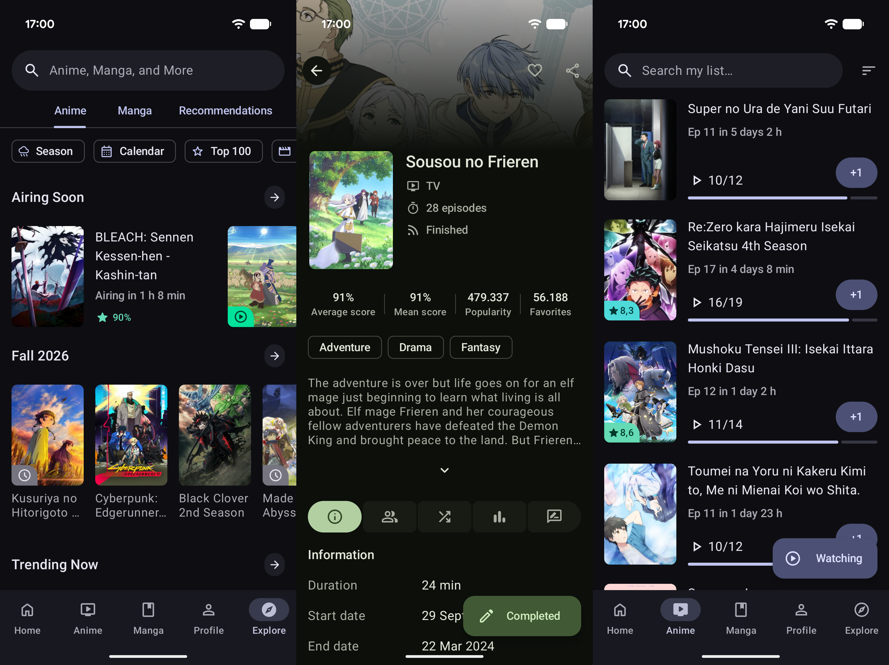

# AniHyou

## 中文增强版

本分支从上游 `927c0f15` 重新实现中文增强：保留原始 AniList 数据，独立处理
中文显示、可追溯别名检索、繁简匹配、在线补充和资源更新。已合并上游 `27fce336`。
应用支持前台自动检查目录更新，下载和安装由用户确认。资源与代码更新的机制、
发布状态和验证边界见维护文档。页面中的商店与上游链接仍指向原项目，
不代表本 fork 已上架；历史 Release APK 也不包含本次重设计。

- [架构与旧方案对照](docs/localization/ARCHITECTURE_DECISIONS.md)
- [功能和验证范围](docs/localization/IMPLEMENTATION_STATUS.md)
- [搜索性能与覆盖](docs/localization/SEARCH_PERFORMANCE.md)
- [来源与重建](docs/localization/SOURCES.md)
- [目录导入、恢复和更新](docs/localization/CATALOG_UPDATES.md)
- [本地 APK、哈希与交付范围](docs/localization/DELIVERY.md)
- [仓库迁移、上游同步与资源维护](docs/localization/MAINTENANCE.md)

[](https://github.com/axiel7/MoeList/releases/latest)
[](https://crowdin.com/project/anihyou)
[](https://ko-fi.com/axiel7)

Another unofficial Android AniList client

[](https://play.google.com/store/apps/details?id=com.axiel7.anihyou)
[](https://f-droid.org/packages/com.axiel7.anihyou)

iOS version [here](https://github.com/axiel7/AniHyou-iOS)

Follow the development on the official Discord server:

[](https://discord.gg/CTv3WdfxHh)

# Screenshots


## Coming features
- [See project](https://github.com/users/axiel7/projects/2/views/1)

# Donate 💸
Support the development of AniHyou by making a donation via:

[Ko-Fi](https://ko-fi.com/axiel7)

BTC
```
3KKjJuorh9se2jUo1Hr6MFgXhnBWbj5fTP
```

ETH
```
0xBd20dD0e036B246F879EeFde52601f0fBbeC69c0
```

LTC
```
MRw5XPLsM9SVf48tv4nwQoY12nMXaiVzmD
```
